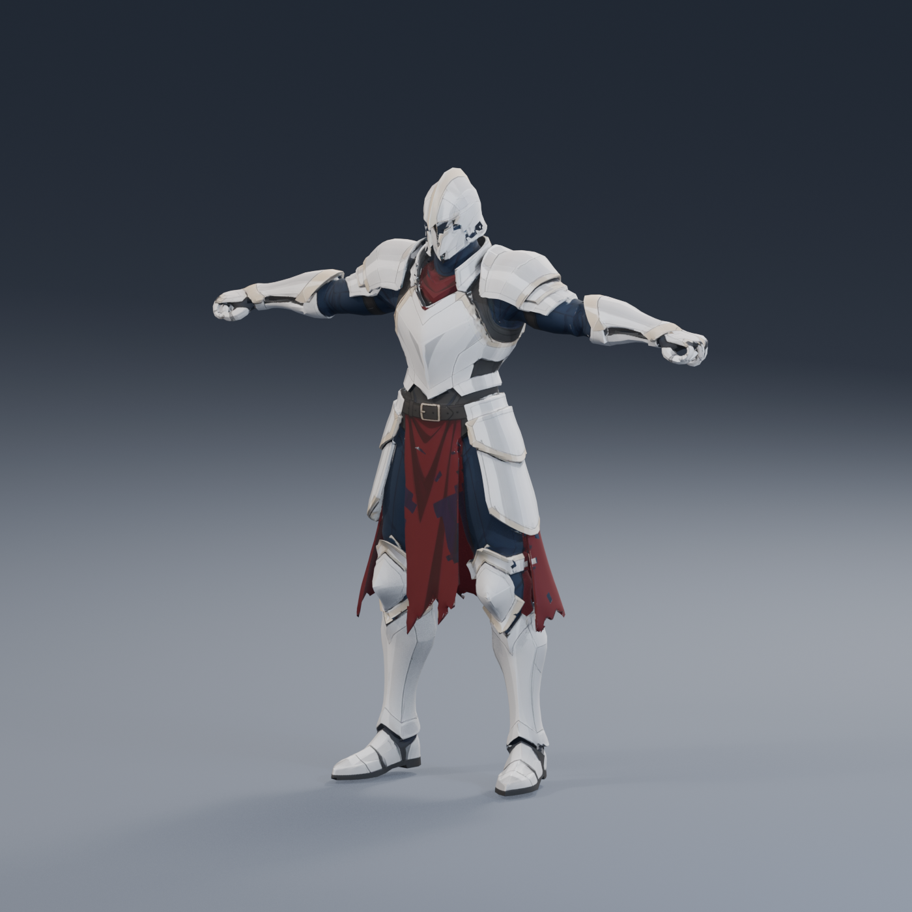

# Wojownik — pierwsza próba gotyckiego anime

2026-10-23. Źródła PoC do oceny, przed rigowaniem i integracją z Unity.

**Aktualizacja 2026-10-26:** na podstawie wersji v2 przygotowano [rigowanego paladyna i wdrożono go do gry](../Paladin/README.md).
Pliki tego katalogu pozostają źródłami; aktualny model gry leży w `Models/PoC/PaladinAnime/`.
Zgodnie z nową decyzją użytkownika dotychczasowy wojownik w grze nie został zmieniony.



## Wersja do dalszej pracy — v2, stały chwyt dłoni

Na prośbę użytkownika zwinięto cztery palce i ułożono kciuk obu dłoni do trzymania broni.
Edycję wykonano lokalnie w Blenderze, bez kolejnych kredytów Meshy. Oryginalne pliki v1 pozostają zachowane.

- [warrior-v2-grip.blend](warrior-v2-grip.blend) — model roboczy ze spakowaną teksturą, bez lamp i walców podglądu.
- [warrior-v2-grip.fbx](warrior-v2-grip.fbx) i [warrior-v2-grip.glb](warrior-v2-grip.glb) — nowe eksporty z teksturą 2K.
- [Lewa dłoń](warrior-v2-grip-left-hand.png) i [prawa dłoń](warrior-v2-grip-right-hand.png) — obejrzane zbliżenia
  z próbną rękojeścią 25 mm. Walce służą tylko sprawdzeniu prześwitu; nie są częścią eksportowanego modelu.
- [grip-edit.json](grip-edit.json), [grip-audit.json](grip-audit.json) — zakres zmiany i ponowny import obu eksportów.

Wersja v2 pochodzi z oryginalnego GLB: 39 204 wierzchołki, **45 832 trójkąty**, jeden materiał, tekstura 2048×2048.
Zmieniono 853 wierzchołki lewej i 879 prawej dłoni. Po normalizacji do wysokości 1,8 m geometria poza dłońmi jest identyczna
z oryginałem (sprawdzenie po indeksach wierzchołków, różnica 0). Początek układu znajduje się na poziomie podłoża.
Oba eksporty ponownie wczytano z teksturą. Nadal brak szkieletu, wag i animacji; dopasowanie chwytu do konkretnego miecza/tarczy
oraz sprawdzenie deformacji pozostają częścią integracji. Skrypt odtworzenia: `tools/art/curl_warrior_fingers.py`.

## Istniejący szkielet i następna sesja

Sprawdzono `Models/Heroes/hero_warrior/hero_warrior.fbx` z kopii w Turris: 26 kości,
komplet sprawdzonych kości tułowia/kończyn i gniazda `HandSlot.R/L`, bez kości palców dłoni.
To odpowiednia baza do dopasowania i nadania wag. Nie wystarczy podłączyć statycznej siatki do starego awatara.
Raport: [rig-audit.json](rig-audit.json); nakładki [z przodu](rig-fit-front.png) i [z boku](rig-fit-side.png), obejrzane.
Nakładki przedstawiają pierwotny model v1 oraz niedopasowany jeszcze rig w skali gry.

**Dalsze kroki:** [plan wdrożenia w następnej sesji](../../../docs/PLAN_WDROZENIA_WOJOWNIKA_ANIME.md).

## Pochodzenie i koszt

- Referencja: [warrior-reference-v1.png](../../../docs/concepts/2026-10-23/meshy/warrior-reference-v1.png), image_gen, bez kredytów Meshy.
- Parametry: [warrior-job-v1.json](../../../docs/concepts/2026-10-23/meshy/warrior-job-v1.json).
- Oficjalny Meshy MCP 0.6.5, `image-to-3d`, Meshy 7.1, standardowa geometria, kolor 2K, bez PBR.
- Zadanie: `01a16a0a-a6e5-77cc-81be-c97226baf934`; stan `SUCCEEDED`.
- Jedna płatna generacja: **30 kredytów**, saldo API **159 → 129**. Bez płatnych dodatków i ponowień.
- Klucz API pozostaje w lokalnej konfiguracji użytkownika; ten katalog go nie zawiera.

## Pliki

| Plik | Zawartość |
|---|---|
| [warrior-v1.glb](warrior-v1.glb) | Oryginalny model Meshy, tekstura w pliku |
| [warrior-v1.fbx](warrior-v1.fbx) | Oryginalny eksport FBX, w większości czworokąty |
| [warrior-v1_base_color.png](warrior-v1_base_color.png) | Mapa koloru 2048×2048 pobrana z modelem |
| [warrior-v1-preview.blend](warrior-v1-preview.blend) | Scena studyjna, spakowana tekstura, wysokość prezentacyjna 1,8 m |
| [Przód](warrior-v1-front.png), [¾](warrior-v1-three-quarter.png), [tył](warrior-v1-back.png) | Rendery rzeczywistego GLB, obejrzane po wygenerowaniu |
| [audit.json](audit.json) | Pomiary osobnych importów GLB i FBX w Blenderze 5.2.2 |

## Sprawdzenie i ograniczenia

Oba formaty wczytują się z teksturą, jedną siatką, jednym materiałem i jednym zestawem UV.
GLB ma **45 832 trójkąty**. FBX ma **23 291 wielokątów** (22 582 czworokąty, 701 trójkątów i 8 pięciokątów),
czyli **45 889 trójkątów** po triangulacji. Zadane 20 000 jest celem generatora, a nie osiągniętym limitem trójkątów.
W oryginalnym imporcie wysokość wynosi około 1,884 jednostki; środek modelu jest blisko początku układu.
Ustawienie stóp na podłożu i wysokość 1,8 m dotyczą wyłącznie pliku podglądu `.blend`.

Nie ma szkieletu, wag ani animacji. Nie sprawdzono działania postaci w Unity ani deformacji przy istniejących animacjach.
Przed użyciem w grze trzeba oczyścić dłonie i łączenia pancerza, poprawić okolice szyi,
ocenić powtórzoną klamrę pasa z tyłu, dopasować rig i wagi oraz zapewnić sztywność stalowych płyt i butów.
W razie potrzeby uprościć geometrię lokalnie. Oryginalne eksporty zachowano bez zmian.

Podgląd odtwarza skrypt [preview_meshy_warrior.py](../../../tools/art/preview_meshy_warrior.py):

```powershell
& 'C:/Program Files/Blender Foundation/Blender 5.2/blender.exe' -b --python tools/art/preview_meshy_warrior.py
```

Uruchomić z katalogu głównego Turris. Skrypt pracuje lokalnie, bez Meshy i bez kosztu kredytów.
Nie zmienia plików rozgrywki ani Hell Unleashed.
