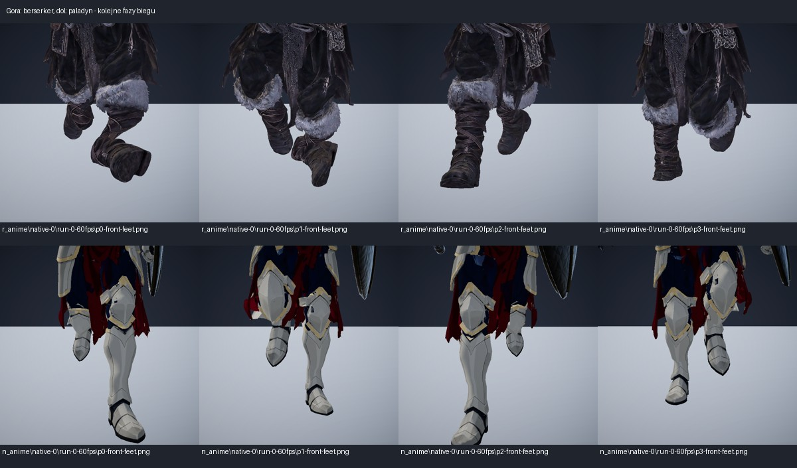

# Weryfikacja nóg, kostek i podparcia bohaterów

Data: 2026-10-29. Audyt zlecony po [planie weryfikacji](PLAN_WERYFIKACJI_ANATOMII_BOHATEROW.md).

**Aktualizacja:** po doprecyzowaniu celu wdrożono [naprawę 14 wyglądów](NAPRAWA_KOSTEK_BOHATEROW.md).
Poniższe liczby i oceny opisują stan **sprzed naprawy**, zachowany jako odniesienie do porównań.

**Wniosek: problem berserkera został odtworzony. Nie ogranicza się do nowego modelu Meshy.**
W pozostałych wyglądach również występują sygnały asymetrii; paladyn zachowuje wcześniejszą
poprawę ustawienia kostek w biegu do przodu. Nie oznacza to zaliczenia całej anatomii paladyna:
pomiar geometrii wykazał osobny sygnał kontaktu prawego buta z podłożem.

Zakres obejmował **audyt, bez napraw**. Nie zmieniono modeli, animacji, materiałów, ustawień
klas ani globalnych parametrów korekty stóp. Wojownik był wyłącznie obserwowany.
Hell Unleashed nie był modyfikowany. Nie wykonano commita ani pusha.

## 1. Co rzeczywiście uruchomiono

- Główny edytor `C:/GIT/Gry/Turris_Damnatorum`, Unity 6000.6.3f1, URP, Linear/D3D12.
  Test Runner uruchamiany przez MCP, bez drugiego edytora tego projektu.
- **15 aktywnych wyglądów**, rozwiązanych przez `ClassDefinition.Visual`, w tym aktualne
  podmiany anime oraz paladyn jako kontrola. Nie ograniczano badania do starych prefabów.
- **27 zestawów startowych + 90 dodatkowych profili**, łącznie **117 kombinacji**.
  Dodatkowe profile na każdym rigu: jednoręczna bez tarczy, z tarczą, dwuręczna, łuk,
  kostur i dwa ostrza. Pełne wyposażenie i użyte klipy są w `TestResults/hero-anatomy/coverage.csv`.
- Na każdej kombinacji: spoczynek, chód i bieg w ośmiu kierunkach przy prędkościach zestawu,
  bieg do przodu przy 30 kl./s, przejścia i syntetyczne akcje. **2106 przypadków ruchu,
  352 665 próbek czasu po rozgrzaniu grafu**, obie nogi; dla ruchu minimum trzy pełne cykle.
- Sekwencje syntetyczne obejmowały ruszanie/hamowanie, zwroty 90°/180°, zmianę kierunku,
  okrążanie, ciosy, ciężki zamach, blok/parowanie, czar, strzał, unik/skok w tył i reakcję na trafienie.
  To próba sterownika; nie jest dowodem, że każda z wymuszonych akcji jest dostępna każdej broni.
- Osobny przebieg prawdziwej sceny Main i kamery gry: 15 klas, dwa zestawy berserkera.
  Następnie **wszystkie 27 natywnych zestawów** z rzeczywistym `PlayerCombat`, sprzętem,
  akceptowanymi akcjami i klipami: **36 690 próbek czasu**. Logi potwierdzają trzy rozpoczęte
  lekkie uderzenia/strzały na każdym zestawie; młot berserkera powtórzono z poprawionym wejściem testu.
- **18 kontroli porównawczych**: aktywne 15 modeli oraz stare rigi berserkera, maga i paladyna
  z tymi samymi zestawami klipów broni. Zapis etapów korekty, sekwencje normalne/zwolnione,
  cztery fazy z przodu, tyłu i boków, zbliżenia, szkielety i wycinki nóg.
- Dodatkowy **BakeMesh co klatkę dla wszystkich 15 modeli** na płaszczyźnie `y=0`.
  Na arenie porównanie z widoczną geometrią podłogi w osobnej scenie fizyki; pomiar nie dodaje
  kolizji do świata gracza. Collider areny leży na `y=0`, widoczna geometria zawiera niższe fugi.

Pierwotny przebieg podeszew oparty na CPU skinningu nie zgadzał się dostatecznie z BakeMesh
dla części starszych modeli. Te wyniki oznaczono jako niewiarygodne, zamiast uznać je za poprawne.
Wyniki kontaktu w tym raporcie pochodzą z **rzeczywiście wypieczonych wierzchołków**.

## 2. Jak czytać wyniki

Skręt liczono względem płaszczyzny kolana i goleni. Przy zgięciu kolana poniżej 25° pomiar
jest niewiarygodny i zapisuje `NaN`, nie zero. Porównanie wymachu obejmuje kolana zgięte
powyżej 60°, po odbiciu prawej nogi i wyrównaniu faz do szczytu zgięcia; 32 przedziały cyklu.
Kąty w przedziałach są uśredniane kołowo. P95 nie jest średnią całego ruchu.

**Wartości są sygnałami do oceny animacji, nie medyczną diagnozą ani uniwersalną normą.**
Próg >12° oznacza potrzebę obejrzenia asymetrii, a >2 cm — potrzebę oceny kontaktu z podłożem.
Skręt kostki, pochylenie buta i jego kontakt to osobne wyniki. Nie stosowano dawnego wyjątku dla łucznika.

Ślizg śledzi ten sam wierzchołek tylko w stabilnym oknie kontaktu; środek stopy podczas
przetaczania nie jest stałym punktem podparcia. **Brak odpowiedniego okna = brak danych**,
nie zaliczony test i nie ślizg 0 cm. Analogicznie nie podaje się zera przy braku wiarygodnej
płaszczyzny kolana albo zasłoniętej podeszwie.

## 3. Wyniki domyślnych zestawów w biegu do przodu

Tabela dotyczy `native-0/run-0-60fps`. Kolumna N to liczba porównanych przedziałów fazy,
nie liczba klatek. Pełne maksima, P95, liczności i fazy zdarzeń są w `metrics.json` każdego przypadku.
Podane zapadanie dotyczy zaznaczonych punktów siatki w regionie stóp względem płaszczyzny
kontrolnej, nie wysokości samej kości kostki. Przy szatach wymaga również oceny, czy punkt należy
do buta, czy materiału przypisanego wagami do nogi.

<!-- TABELA_WYNIKOW -->
| Postać / aktywny wygląd | Zestawy startowe + profile | N faz | Asymetria P95 / max | Zapadanie L/P, max | Ocena |
|---|---:|---:|---:|---:|---|
| [Łucznik arkanów](qa/hero-anatomy-2026-10-29/class_hu_arcane_archer.jpg) · `visual_hero_rogue_arcane_archer` | 1 + 6 | 8 | 128.4° / 131.4° | 0.0 / 5.3 cm | podejrzenie |
| [Łucznik](qa/hero-anatomy-2026-10-29/class_hu_archer.jpg) · `visual_hero_rogue_archer` | 1 + 6 | 8 | 113.1° / 116.3° | 0.0 / 4.8 cm | podejrzenie |
| [Zabójca](qa/hero-anatomy-2026-10-29/class_hu_assassin.jpg) · `visual_hero_rogue_assassin` | 2 + 6 | 11 | 149.9° / 176.1° | 4.6 / 3.2 cm | podejrzenie |
| [Mag bitewny](qa/hero-anatomy-2026-10-29/class_hu_battlemage.jpg) · `visual_hero_mage_battle` | 4 + 6 | 12 | 27.6° / 46.4° | 5.6 / 7.7 cm | podejrzenie |
| [Berserker](qa/hero-anatomy-2026-10-29/class_hu_berserker.jpg) · `visual_berserker_anime` | 2 + 6 | 9 | 35.7° / 35.8° | 5.7 / 10.2 cm | błąd odtworzony |
| [Rębajło](qa/hero-anatomy-2026-10-29/class_hu_dual.jpg) · `visual_hero_warrior_dual` | 2 + 6 | 12 | 36.3° / 53.5° | 7.2 / 8.3 cm | podejrzenie |
| [Mag powietrza](qa/hero-anatomy-2026-10-29/class_hu_mage_air.jpg) · `visual_hero_mage_air` | 1 + 6 | 12 | 57.0° / 110.0° | 5.7 / 7.4 cm | podejrzenie |
| [Mag ziemi](qa/hero-anatomy-2026-10-29/class_hu_mage_earth.jpg) · `visual_hero_mage_earth` | 1 + 6 | 12 | 104.0° / 174.1° | 4.9 / 8.9 cm | podejrzenie |
| [Mag ognia](qa/hero-anatomy-2026-10-29/class_hu_mage_fire.jpg) · `visual_hero_mage_fire` | 1 + 6 | 11 | 94.8° / 113.1° | 8.1 / 10.0 cm | podejrzenie |
| [Mag wody](qa/hero-anatomy-2026-10-29/class_hu_mage_water.jpg) · `visual_hero_mage_water` | 1 + 6 | 12 | 139.9° / 166.3° | 3.1 / 5.2 cm | podejrzenie |
| [Paladyn](qa/hero-anatomy-2026-10-29/class_hu_paladin.jpg) · `visual_paladin_anime` | 2 + 6 | 12 | 2.3° / 2.3° | 1.4 / 2.7 cm | skręt poprawny w tej próbie; podejrzenie kontaktu |
| [Przywoływacz](qa/hero-anatomy-2026-10-29/class_hu_summoner.jpg) · `visual_hero_mage_summoner` | 1 + 6 | 12 | 44.2° / 58.8° | 1.4 / 6.1 cm | podejrzenie po kościach; brak pełnej oceny buta pod szatą |
| [Wojownik](qa/hero-anatomy-2026-10-29/class_knight.jpg) · `visual_hero_warrior` | 2 + 6 | 12 | 116.1° / 168.0° | 4.8 / 6.7 cm | podejrzenie; tylko odczyt |
| [Mag (anime)](qa/hero-anatomy-2026-10-29/class_mage.jpg) · `visual_mage_anime` | 4 + 6 | 11 | 49.7° / 63.9° | 11.7 / 12.3 cm | podejrzenie |
| [Łotrzyk](qa/hero-anatomy-2026-10-29/class_rogue.jpg) · `visual_rogue_hooded_meshy` | 2 + 6 | 8 | 101.7° / 105.2° | 1.7 / 2.9 cm | podejrzenie |
<!-- KONIEC_TABELI_WYNIKOW -->

Wyniku nie należy przenosić na inne bronie/kierunki. Wszystkie ich kombinacje mają osobne
CSV i metryki. Status „poprawny” może dotyczyć konkretnego pomiaru, nie automatycznie całej klasy.

## 4. Berserker — odtworzona usterka i miejsce powstawania

[Sekwencja biegu](qa/hero-anatomy-2026-10-29/berserker-run-normal.gif) ·
[zwolniona sekwencja](qa/hero-anatomy-2026-10-29/berserker-run-slow.gif) ·
[stary rig, te same klipy](qa/hero-anatomy-2026-10-29/berserker-old-rig.jpg).

- Aktywny model `visual_berserker_anime`, obie bronie: `hu_greataxe`, `hu_warhammer`.
  Bieg do przodu: klip `great sword run (2)`, prędkość zestawu około **4,08 m/s**.
- Asymetria wymachu powtarza się przy **30 i 60 kl./s**. Zbliżenia pokazują nieprawidłowe
  ustawienie buta względem goleni; nie jest to wyłącznie wrażenie z kamery gry.
- Gęsty zapis etapów w tym samym przebiegu: średni podpisany skręt podczas zgięcia >60°
  po retargetowaniu **L +73,85° / P −1,65°**; po `ApplyFootYaw` **L +9,62° / P −32,83°**.
  Reset palców nie zmienia tego wyniku; następne warstwy do pozy końcowej również go nie usuwają.
  Korekta zmniejsza duży błąd lewej strony, lecz jednocześnie skręca prawą. To wskazuje
  na problem współdziałania retargetu, referencji i korekty w wymachu.
- Na starym rigu berserkera z tym samym zestawem również występuje duża asymetria.
  W gęstym pomiarze po retargetowaniu **L +90,55° / P +67,20°**, po korekcie
  **L +22,67° / P +67,20°**. To nie uzasadnia generowania nowej siatki ani kopiowania
  ustawień paladyna na cały katalog.
- BakeMesh na płaskiej powierzchni: maksymalne zapadanie badanych punktów butów
  **L około 5,7 cm / P około 10,2 cm**. Ten wynik jest osobny od asymetrii kostek.

Są to pomiary konkretnego biegu i profilu, nie dowód, że sam oryginalny plik Mixamo ma wadę.
„Po retargetowaniu” zawiera już wynik Unity Humanoid. Do ostatecznego przypisania winy
samemu nagraniu potrzebne byłoby porównanie na jego oryginalnym awatarze, niezależne od retargetu.

## 5. Co poprawić w kolejnym zleceniu

1. **P1 — berserker:** rozdzielić referencję kierunku stopy w podporze i w wymachu;
   zweryfikować wpływ `MeasureFootYaw`/`ApplyFootYaw` oraz mapowania awatara. Sprawdzać obie nogi.
   Nie zwiększać globalnych `FootFixStanceGain` i `FootFixSwingGain`.
2. **P1 — wspólne testy:** stary test `Run_FeetInStancePointLikeRestPose` bada cztery dawne
   modele z mieczem, nie aktywne wyglądy i natywne bronie. Przy braku próbek potrafi zwrócić zero;
   łucznik ma dodatkowy wyjątek od oceny asymetrii. Tę lukę należy usunąć przy naprawie,
   zamiast dopasować animację do testu, który problemu nie widzi.
3. **P1/P2 — pozostałe rigi:** osobna korekta dla potwierdzonych par model–profil, po kontroli
   klipu i osi. Mag, Rębajło oraz modele łuczników wymagają uwagi; wskazania pozostałych
   postaci są wymienione w tabeli. Dla szat najpierw rozdzielić but od tkaniny w ocenie geometrii.
4. **P2 — kontakt:** skontrolować wysokość i prowadzenie podeszwy, nie tylko yaw kości.
   Osobno sprawdzić fizyczną płaszczyznę `y=0`, płytę kamienną i fugę; niska fuga nie jest
   automatycznie zapadaniem postaci przez collider.
5. **Wojownik:** wyłącznie raport; jego naprawę lub zmianę wyglądu trzeba zlecić osobno.

Nie wykonano powyższych napraw w ramach audytu.

## 6. Dowody i odtwarzanie

- `TestResults/hero-anatomy/audit-live.xml`: główny przebieg **3 zaliczone / 0 błędów**.
- `followup-live.xml`: źródłowe rigi i sekwencje **1 / 0**.
- `contacts-live.xml`: podparcie i 27 natywnych zestawów **2 / 0**.
- `berserker-series-live.xml`: powtórzenie serii obu broni berserkera **1 / 0**.
- **Łącznie 6 różnych testów, 7 zakończonych wykonań bez błędu infrastruktury.** Zaliczenie
  testów oznacza zebranie danych i wymagane pokrycie, nie prawidłową anatomię wszystkich modeli.

Pierwszy próbny przebieg przerwano po błędach narzędzia pomiarowego: odczycie starej siatki
z wyłączonym Read/Write i zbyt wysokiej minimalnej liczbie klatek szybkiego cyklu.
Poprawiono odczyt przez API edytora i warunek pełnych cykli; powyższe XML opisują udane powtórzenia.

- `coverage.csv`, `metrics-all.json`, `native-actions-summary.json`: macierz i pomiary zbiorcze.
- `<classId>/<visual>/native-N/`: manifest, klipy, kierunki, CSV i cztery widoki kolejnych faz.
- `diagnostic-active/` oraz `diagnostic-old-rig-same-sets/`: gęsty zapis etapów, wycinki nóg,
  szkielety, porównania i GIF-y `sequence-*-normal.gif` / `sequence-*-slow.gif`.
- `baked-contact/`: geometria co klatkę i `contact-metrics.json`; `native-arena-N/`: rzeczywiste
  akcje, punkty podparcia i wysokość widocznej podłogi. `arena-N/`: normalny ruch z kamerą gry.
- `protected-source-check.json`: **8/8 zachowanych hashy źródłowych**, w tym modele/tekstury
  maga i berserkera oraz definicja wojownika.

Narzędzia: `HeroAnatomyAuditPlayTests`, `HeroAnatomyLiveRunner`,
`tools/art/review_hero_anatomy.py`. Testy są opt-in, zwykły przebieg ich nie uruchamia.
Menu w Unity: **Turris → Audyt anatomii**. Analiza: `python tools/art/review_hero_anatomy.py`;
szybkie przeliczenie liczb bez renderowania plansz: opcja `--metrics-only`.

Nie są to pomiary wydajności gry. Główna macierz steruje czasem animacji ręcznie, a przebieg
natywnych akcji używa publicznego `PlayerCombat.Tick`; zwykły ruch kontrolera sprawdzono
osobno na Main. Nie poświadczono działania każdej umiejętności ani każdej broni w walce z AI.
Pełny brak ślizgu i poprawność butów zasłoniętych tkaniną pozostają **niepotwierdzone** tam,
gdzie nie było wiarygodnych okien kontaktu lub rozdzielonej geometrii buta.

Nie ma podstaw do stwierdzenia „wszystkie postacie są poprawne”. Audyt wskazuje obszary
naprawy i zachowuje surowe dane do porównań przed/po.
